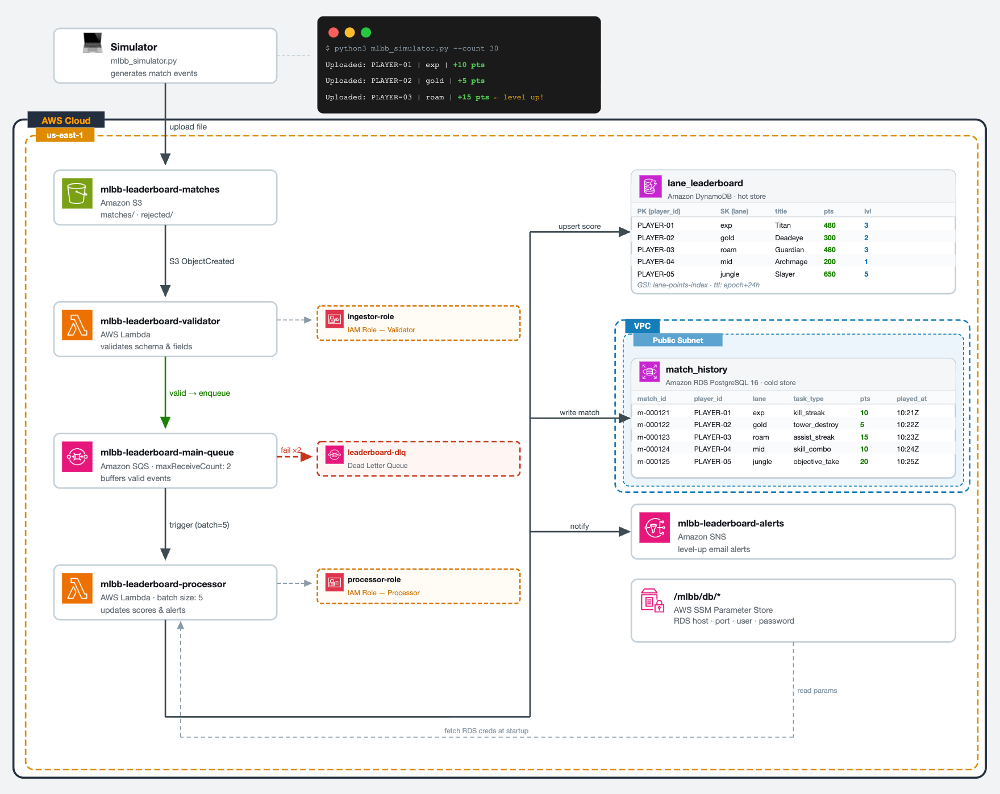

# MLBB Lane Leaderboard — Event-Driven Pipeline on AWS



Event-driven pipeline that turns MLBB match files into a near real-time lane leaderboard using S3, Lambda, SQS, DynamoDB, RDS PostgreSQL, and SNS.

## Quick Start

**1. Prerequisites**
- AWS CLI configured (`aws configure`)
- Terraform >= 1.5
- Python 3.12
- `psycopg2-binary` (`pip install psycopg2-binary`)

**2. Configure**
```bash
cp terraform/terraform.tfvars.example terraform/terraform.tfvars
# edit terraform/terraform.tfvars — set your alert_email
```

**3. Build Lambda zips**
```bash
make build
```

**4. Provision**
```bash
make init
make apply
```
> Confirm the SNS subscription email before running the demo.

**5. Seed + Demo**
```bash
make seed
make demo
```

## Failure Demos

```bash
make bad        # invalid file → rejected/
make duplicate  # same match_id twice → skipped
make poison     # corrupt payload → DLQ after 2 retries
```

## Cleanup

```bash
make destroy
```

## Project Structure

```
├── terraform/                  # all infrastructure as code
├── src/
│   ├── common/                 # tiers.json — lane titles and level thresholds
│   ├── validator/              # validates and routes match files
│   └── processor/              # updates scores, history, and alerts
├── simulator/                  # generates and uploads match events
├── scripts/                    # build_lambdas.sh, seed.py
├── sql/                        # schema.sql, queries.sql
├── build/                      # generated by build_lambdas.sh, not committed
└── Makefile
```
